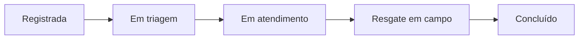
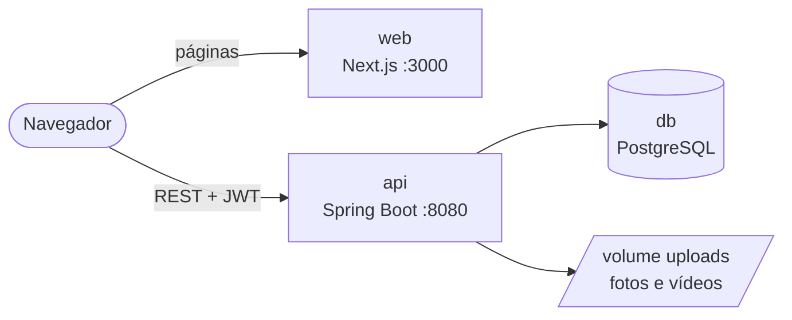

<p align="center">
  
</p>

<h1 align="center">Portal Instituto Caapora</h1>

<p align="center">
  Plataforma de registro e acompanhamento de resgates de animais silvestres.<br/>
  Qualquer pessoa informa onde um animal precisa de ajuda; a equipe do instituto recebe, organiza e atende.
</p>

<p align="center">
  
  
  
  
  
  
</p>

---

## Sobre o projeto

O **Instituto Caapora** atua na proteção e no resgate da fauna silvestre brasileira. O portal centraliza
os chamados de resgate em um só lugar, com registro padronizado e retorno para quem avisou, em duas frentes:

- **Para a população:** um formulário rápido, pensado para o celular, para registrar a ocorrência
  (onde está o animal, o que aconteceu, fotos) e um **número de protocolo** para acompanhar o resgate.
- **Para a equipe do instituto:** um painel para triar os chamados, definir urgência, despachar equipes
  de campo e acompanhar indicadores.

## Funcionalidades

### Área pública

| Tela | Rota | O que faz |
|---|---|---|
| Página inicial | `/` | Apresenta o instituto, explica como funciona e leva ao registro |
| Registrar ocorrência | `/registrar` | Fluxo em 3 etapas: **localização** (GPS ou endereço), **animal** (tipo, espécie, estado de saúde, descrição e até 5 fotos/vídeos) e **contato** (com opção de anonimato). Ao final, mostra o protocolo |
| Acompanhar ocorrência | `/acompanhar` | Busca pelo número de protocolo (`CAA-AAMMDD-XXXXX`) |
| Detalhes da ocorrência | `/acompanhar/[protocolo]` | Situação atual, animal, local, equipe responsável e linha do tempo do atendimento |

### Área interna (equipe do instituto)

O backend já oferece as APIs; as telas do painel estão desenhadas no Figma e em desenvolvimento.

- **Login** com JWT e perfis de acesso (`COORDENADOR`, `ATENDENTE`, `EQUIPE_CAMPO`)
- **Ocorrências:** lista, filtros, cadastro manual (chamados por telefone), mudança de status e urgência, atribuição de equipe e histórico
- **Dashboard:** totais, distribuição por status, categoria e mês, e **mapa de calor** das ocorrências
- **Equipes e funcionários:** cadastro, disponibilidade e detalhes
- **Relatórios** por período

### Como um resgate anda



Cada mudança de status fica registrada com data e hora e aparece na linha do tempo que o cidadão
consulta pelo protocolo.

## Tecnologias

| Camada | Tecnologias |
|---|---|
| **Frontend** | Next.js 16 (App Router), React 19, TypeScript, Tailwind CSS 4, shadcn/ui (Radix), Lucide |
| **Backend** | Java 17, Spring Boot 4 (Web MVC, Data JPA, Validation, Security), JWT (JJWT), springdoc-openapi, Lombok |
| **Banco de dados** | PostgreSQL 17 |
| **Infraestrutura** | Docker, Docker Compose, Easypanel |

## Arquitetura



- O **navegador** chama a API diretamente (endereço definido em `NEXT_PUBLIC_API_URL`).
- Fotos e vídeos ficam no volume `uploads` e são servidos pela própria API em `/uploads/...`.
- A consulta pública por protocolo **não expõe dados de quem registrou** nem nomes de funcionários, e o
  endereço é mostrado sem número (LGPD).

## Estrutura do repositório

```
.
├── backend/                  # API Spring Boot
│   └── src/main/java/com/inovatech/portal_instituto_caapora/
│       ├── config/           # segurança (JWT), CORS, OpenAPI, uploads
│       ├── controller/       # endpoints REST
│       ├── service/          # regras de negócio
│       ├── database/         # entidades JPA, enums e repositórios
│       ├── dto/              # objetos de requisição e resposta
│       └── handler/          # tratamento global de erros
├── frontend/                 # site Next.js
│   └── src/
│       ├── app/              # páginas (/, /registrar, /acompanhar)
│       ├── components/ui/    # componentes shadcn/ui
│       └── lib/              # cliente da API e utilitários
├── docker-compose.yml        # produção (Easypanel), sem portas publicadas
├── docker-compose.local.yml  # abre as portas para uso local
└── .env.example              # todas as variáveis de ambiente
```

## Como rodar

### Com Docker (recomendado)

Pré-requisito: [Docker Desktop](https://www.docker.com/products/docker-desktop/).

```bash
cp .env.example .env
docker compose up --build
```

O `.env` já inclui o `docker-compose.local.yml`, que abre as portas. Sem o `.env`, rode
`docker compose -f docker-compose.yml -f docker-compose.local.yml up --build`.

| Serviço | Endereço |
|---|---|
| Site | <http://localhost:3000> |
| API | <http://localhost:8080> |
| Documentação da API (Swagger) | <http://localhost:8080/swagger-ui/index.html> |
| PostgreSQL | `localhost:5433` (usuário e senha do `.env`) |

- Os dados ficam nos volumes `db-data` (banco) e `uploads` (arquivos).
- Para parar: `docker compose down`. Para apagar também os dados: `docker compose down -v`.

### Sem Docker (desenvolvimento)

**Frontend** (Node.js 24):

```bash
cd frontend
npm install
npm run dev
```

**Backend** (JDK 17 e um PostgreSQL rodando em `localhost:5432`):

```bash
cd backend
./mvnw spring-boot:run
```

Fora do Docker, o banco é recriado a cada inicialização (`DDL_AUTO=create-drop`).

### Testes

```bash
cd backend && ./mvnw test     # testes dos services e DTOs
cd frontend && npm run lint   # lint do frontend
```

O teste `PortalInstitutoCaaporaApplicationTests` sobe a aplicação inteira e precisa do PostgreSQL rodando.
No Windows, use `mvnw.cmd` no lugar de `./mvnw`.

## Principais endpoints

A documentação completa e interativa fica no **Swagger** (`/swagger-ui/index.html`).

| Método | Rota | Acesso | Descrição |
|---|---|---|---|
| `POST` | `/ocorrencias/publica` | público | Registra uma ocorrência e devolve o protocolo |
| `POST` | `/ocorrencias/publica/{protocolo}/midias` | público | Envia foto ou vídeo (até 5 por ocorrência) |
| `GET` | `/ocorrencias/rastreio/{protocolo}` | público | Consulta pública do andamento |
| `POST` | `/auth/login` | público | Login da equipe, devolve o token JWT |
| `GET` | `/ocorrencias`, `/ocorrencias/filtro` | equipe | Lista e filtra ocorrências |
| `PATCH` | `/ocorrencias/{id}/status`, `/urgencia`, `/equipe` | equipe | Atualiza o atendimento |
| `GET` | `/dashboard/*` | atendente, coordenador | Indicadores e mapa de calor |
| `*` | `/equipes`, `/funcionarios`, `/perfis` | coordenador | Gestão da equipe |

## Configuração

Todas as variáveis estão descritas em [`.env.example`](.env.example). As principais:

| Variável | Para que serve |
|---|---|
| `DB_PASSWORD` | Senha do PostgreSQL |
| `JWT_KEY` | Chave de assinatura dos tokens (obrigatória fora do ambiente local) |
| `NEXT_PUBLIC_API_URL` | URL pública da API usada pelo navegador (gravada no build do frontend) |
| `CORS_ALLOWED_ORIGINS` | Endereços do site autorizados a chamar a API |
| `DDL_AUTO` | Como o Hibernate trata o esquema (`update` no Docker) |
| `TZ_APP` | Fuso horário da API (padrão `America/Sao_Paulo`) |

## Deploy (Easypanel)

O Easypanel usa só o `docker-compose.yml` e gera o próprio `docker-compose.override.yml` a partir dos
domínios configurados no painel. Os nomes de serviço nos domínios precisam existir no compose.

1. **Domínios** (aba *Domains*):
   - site → serviço `web`, porta `3000`
   - API → serviço `api`, porta `8080`
2. **Variáveis de ambiente** (aba *Environment*):
   - `NEXT_PUBLIC_API_URL` = URL pública da API (ex.: `https://api.seudominio.com.br`)
   - `CORS_ALLOWED_ORIGINS` = URL pública do site (ex.: `https://seudominio.com.br`)
   - `DB_PASSWORD` = senha forte
   - `JWT_KEY` = chave nova, gerada com `openssl rand -base64 64`
   - **não** defina `COMPOSE_FILE` no servidor
3. Ao mudar `NEXT_PUBLIC_API_URL`, faça um novo deploy: o valor é gravado no build do frontend.

## Como contribuir

- Cada integrante trabalha na própria branch `member/<nome>` e abre pull request para `dev`.
- `dev` é integrada em `master` nas entregas.
- As mensagens de commit seguem o [Conventional Commits](https://www.conventionalcommits.org/pt-br/v1.0.0/),
  em português e com escopo, por exemplo:

```
feat(frontend:registro): implementa formulário público de registro de ocorrência
fix(backend:ocorrencia): garante protocolo único no banco e trata conflito com 409
```
